# neojac

neojac is a compiler for the Jac programming language: one download with the compiler and
everything a project around a Jac program needs (CPython, Node, Clang and Rust). This repository
is where it is released, and holds what of it is open: the language's abstractions with their
standard plugins, its documentation and its examples.

## Install

On Linux or macOS:

```sh
curl -fsSL https://github.com/jaseci-labs/neojac-releases/releases/latest/download/install.sh | bash
```

The installer downloads the latest release for your platform, verifies its
checksum, unpacks it under `~/.neojac`, and links `~/.local/bin/neojac` to it.
Pass options after `bash -s --`:

```sh
curl -fsSL https://github.com/jaseci-labs/neojac-releases/releases/latest/download/install.sh | bash -s -- --version 0.1.9
curl -fsSL https://github.com/jaseci-labs/neojac-releases/releases/latest/download/install.sh | bash -s -- --uninstall
```

On Windows, download `neojac-<version>-windows-x86_64.zip` from a release and
unpack it; `bin\neojac.exe` finds its runtime beside it.

Every release here is published by neojac's release workflow, and is tagged on
the commit of this repository whose abstractions, plugins and documentation it
ships.

## What is here

| | |
|---|---|
| [`docs/`](docs/) | The documentation `neojac docs` prints, and the skills an agent loads. It starts at [docs/start](docs/start/index.md) |
| [`abstractions/`](abstractions/) | The language's abstractions, a directory each: what carries out `root`, `by llm()`, `:protect`, `@job` and the rest. Each declares itself (`jac.toml`), holds the contract a plugin of it implements (`contract.jac`), and holds its standard plugins: `sqlite`, `accounts`, `http`, `anthropic`, `react`, `vite` and the others |
| [`libraries/`](libraries/) | Libraries the standard plugins declare: `sqlfile`, a SQLite file at a layout |
| [`examples/`](examples/) | Programs written in Jac |

The compiler itself is not in this repository. What it is built on that a program meets is: the
contracts and the plugins of `abstractions/` and the libraries of `libraries/` are compiled into
the programs it builds, and a release ships them, and `docs/`, as they are here. A plugin is
written against its abstraction's contract alone, so anyone with neojac installed can write one,
or replace a standard one ([Plugins](docs/apps/plugins.md)).

neojac is not the open-source `jac` of [jaseci-labs/jac](https://github.com/jaseci-labs/jac),
the language's reference design: the two are separate compilers with separate releases, and both
can be installed on one machine. Where they differ as languages is
[Coming from the reference design](docs/start/coming-from-the-reference-design.md).

[CONTRIBUTING.md](CONTRIBUTING.md) says how a change is made here. Everything in this repository
is under the [MIT license](LICENSE), and so are the released binaries.

## Architecture

One front end and one analysis feed three backends, split by each space's host. The analysis and the backends are the language. A seam is where the language fixes a meaning and a plugin supplies the mechanism. `stdjac` is the framework: the seams' defaults, and what a project may adapt or replace. An ecosystem is something a host reaches, never a host itself.

```mermaid
flowchart TB
    subgraph SRC["Source and declarations"]
        JAC[".jac modules"]
        WIRE["archwire.jac<br/>spaces, apps, profiles, wires"]
        TOML["jac.toml, with neojac.lock<br/>ui, bundler, remote URLs, memory, lint<br/>each ecosystem's packages, and each space's npm tree"]
    end

    subgraph FOREIGN["What the analysis knows of other ecosystems"]
        PYSTUB["Python summaries<br/>typeshed, pystub"]
        TSSTUB["npm summaries: exported names<br/>TypeScript on Node, lib.dom<br/>jsstub"]
        TSMEM["npm member types<br/>and call signatures"]
        NATSTUB["C and Rust interfaces<br/>a C module's headers, a crate's interface<br/>cmod, rmod"]
    end

    subgraph ANALYSIS["The language: one front end, one analysis, the same stages for every host"]
        PARSE["lexer, parser"]
        FRONT["front<br/>modules, wires, spaces, interfaces<br/>access tags, endpoints"]
        CHECK["check<br/>types, names, argument binding<br/>builtins by code, UI rules<br/>each host's limits"]
        REFL["check: compile-time reflection<br/>a type's fields, a function's parameters<br/>unrolled for each type"]
        LINT["lint<br/>the rules jac.toml selects"]
        CROSS["front and check: crossings<br/>which calls cross: copied, may raise<br/>what may cross, who may call<br/>today: every call between spaces crosses, whatever the profiles<br/>awaited only on a JS host, no read-only copies of nodes"]
        REQ["req<br/>what each function needs from where it runs"]
        OWN["own, nogc<br/>ownership, the memory contract"]
        PLACES["kern, req<br/>kernels, and that each host, kernel<br/>and parallel loop provides what its code needs"]
        DISP["dispatch<br/>walker and virtual-method plans"]
        STARTS["starts<br/>which globals are made at program start, running no code<br/>which modules start on their first use<br/>read by gen alone"]
        PARSE --> FRONT --> CHECK --> REQ --> OWN --> PLACES --> DISP --> STARTS
        FRONT --> CROSS
        CHECK --> CROSS
        REFL --> CHECK
        CHECK --> LINT
    end

    JAC --> PARSE
    WIRE --> PARSE
    TOML --> FRONT
    PYSTUB --> FRONT
    PYSTUB --> CHECK
    TSSTUB --> FRONT
    TSMEM --> CHECK
    NATSTUB --> FRONT

    subgraph BACKENDS["Three backends: each reads the recorded facts and emits, nothing else"]
        LLVM["LLVM backend<br/>gen, with kgen for kernels<br/>and typed for sized numbers and vectors"]
        JS["JS backend<br/>js_gen: lowers by type and builtin code<br/>today: a few symbols still found by name"]
        PY["Python backend<br/>py_gen: a CPython AST"]
    end

    DISP --> LLVM
    STARTS --> LLVM
    DISP --> JS
    DISP --> PY

    subgraph SEAMS["Seams: the language fixes the meaning, a plugin supplies the mechanism"]
        BYSEAM["By<br/>what a by call invokes"]
        STORE["Store<br/>where roots come from, how a graph persists<br/>today: stdjac's interface and its SQLite default<br/>archwire's store line is refused"]
        AUTH["Auth<br/>who the caller is<br/>today: stdjac's interface and its accounts<br/>archwire's auth line is refused"]
        TRANSPORT["Transport<br/>how a crossing is carried, at both ends<br/>today: stdjac's interface and its HTTP default, one for a program<br/>archwire's crossing line is refused"]
    end

    FRONT -- "by lowers to stdjac.by's by_call, which calls By.invoke" --> BYSEAM
    CROSS -- "endpoints and crossing calls handed over" --> TRANSPORT

    subgraph STD["stdjac: the framework, as a library a project can adapt or replace"]
        DEFAULTS["The seams' defaults<br/>llm, SQLite, accounts, HTTP and JSON"]
        FRAME["server, remote, codec<br/>the HTTP server, URL layout, wire format<br/>written with reflection, generated by nothing"]
        DECOR["schedule, job, restspec<br/>plain functions that register their target<br/>today: called as a module starts, not written as decorators"]
        ROUTER["Page routes<br/>made from a browser space's page modules<br/>today: front finds the pages and js_gen emits the routes"]
        BIND["UI bindings<br/>React, Preact, React Native, Solid<br/>model: rerender, fine-grained, none"]
        BUNDLE["Bundlers<br/>Vite, Expo with Metro"]
        RTJS["JS runtime, rt/hosts/js<br/>language helpers, crossing client, UI boot<br/>a node space's graph, its walks run from dispatch's plans<br/>today: that graph is in memory, with one root for every caller<br/>and a node space's server is the runtime's own<br/>which serves functions: a walker endpoint and :protect are refused there"]
        RTPY["Python runtime, rt/stdjac/py<br/>objects, the graph, walks run from dispatch's plans"]
    end

    BYSEAM --> DEFAULTS
    STORE --> DEFAULTS
    AUTH --> DEFAULTS
    TRANSPORT --> DEFAULTS
    DEFAULTS --> FRAME
    REFL -- "codecs and request routing" --> FRAME
    BIND --> CHECK
    BIND --> JS
    JS --> BUNDLE
    ROUTER --> BUNDLE

    subgraph SAME["Held to one behavior"]
        RTN["Native runtime<br/>rt/core, in Jac"]
        CONF["tests/lang against lang.out<br/>the same programs on every host<br/>today: native and wasm all, cpython and node all 15 sections<br/>but for 6 and 11 declared gaps, browser and hermes not run"]
        CONF --> RTN
    end

    CONF --> RTJS
    CONF --> RTPY

    subgraph HOSTS["Hosts: where Jac runs"]
        NATIVE["native<br/>executable"]
        WASM["wasm<br/>.wasm module"]
        BROWSER["browser<br/>a tab, or a webview<br/>today: a webview on Linux only"]
        HERMES["hermes<br/>Hermes bytecode"]
        NODEH["node<br/>JS on Node: its own process, or embedded in a native app's"]
        CPY["cpython<br/>Jac as code objects, and .py: its own process, or embedded in a native app's"]
    end

    LLVM --> NATIVE
    LLVM --> WASM
    BUNDLE --> BROWSER
    BUNDLE --> HERMES
    JS --> NODEH
    PY --> CPY

    RTN --> NATIVE
    RTN --> WASM
    RTJS --> BROWSER
    RTJS --> HERMES
    RTJS --> NODEH
    RTPY --> CPY

    FRAME -- "compiled by gen" --> NATIVE
    FRAME -- "compiled by py_gen" --> CPY

    subgraph ECO["Ecosystems: reached, never hosts"]
        CLIB["C and C++"]
        RUST["Rust crates"]
        PYPI["PyPI"]
        NPM["npm"]
    end

    NATIVE -- "in-process" --> CLIB
    WASM -- "compiled in" --> CLIB
    NATIVE -- "linked in" --> RUST
    NATIVE -- "embedded CPython" --> PYPI
    NATIVE -- "embedded Node" --> NPM
    BROWSER -- "bundled" --> NPM
    HERMES -- "bundled" --> NPM
    NODEH --> NPM
    CPY --> PYPI

    MANIFEST["manifest, pkg<br/>each ecosystem's own manifest and lock, written from jac.toml and jac.lock<br/>npm's into eco/, a crate's and a C module's into their own directories<br/>each installer run, and what it wrote taken back"]
    TOML --> MANIFEST
    MANIFEST -- "a space's npm tree" --> FRONT
    MANIFEST --> NPM
    MANIFEST --> PYPI
    MANIFEST --> RUST
    MANIFEST --> CLIB

    subgraph APPS["Apps: spaces in one artifact, chosen per profile"]
        BUILDER["App build, the toolchain's<br/>plans each app's programs, runs the backends and bundlers<br/>assembles the artifact<br/>today: a directory when it carries pages, Python or npm packages<br/>a wasm space only in a page, one cpython and one node space in a native program"]
        APP["An app runs some spaces and serves others<br/>Crossings: carried by each one's Transport<br/>Examples: web, cli, desktop, mobile"]
        BUILDER --> APP
    end

    HOSTS --> BUILDER
```



## Experience NeoJac

[diffwalker](https://github.com/marsninja/diffwalker) is an agentic code
reviewer written in Jac. It is one project with four apps (a web app, a desktop
app, an Android phone app and a command-line app), and neojac builds all of
them with nothing else installed. Working through it uses almost every
`neojac` command. Each step below was run on neojac 0.3.1.

You need neojac 0.3.1 or later, and `git`. An Anthropic API key is optional:
without one, a review's deterministic stages still run and give a verdict, but
the model's stages and the Copilot don't run. Any command explains itself with
`neojac help <command>`.

### 1. Get the project and its packages

```sh
git clone https://github.com/marsninja/diffwalker
cd diffwalker
neojac install
```

`neojac install` installs what `jac.toml` lists, for every ecosystem, and
records it in `jac.lock`. The site's and the phone app's npm packages are
installed with neojac's own Node into `eco/`. Because `jac.toml` has an
`[android]` table, it also fetches a pinned Android SDK, JDK and emulator into
neojac's cache. Nothing is installed globally. `neojac install --frozen`
installs exactly what `jac.lock` pins.

### 2. Read the documentation offline

```sh
neojac docs                   # the map: every page, and what it covers
neojac docs start/primer      # the whole language in one page
neojac docs visit             # what defines a keyword
neojac docs '++>'             # ... or an operator
neojac docs apps/crossings    # how a page's call reaches the server
neojac docs E1307             # what a diagnostic code means, and the fix
neojac docs search stream     # the pages that mention a text
neojac skills                 # playbooks for coding agents
neojac skills install         # ... copied into .agents/skills
```

The documentation ships inside the release and matches its version.

### 3. See the architecture

diffwalker's modules write no imports. Every import is a wire in
[`archwire.jac`](https://github.com/marsninja/diffwalker/blob/main/archwire.jac),
which also declares the spaces code runs in and the apps made of them.
`neojac arch` draws all of that:

```sh
neojac arch --text                        # the packages and the wires between them
neojac arch core --text                   # one package, opened
neojac arch --view spaces --text          # the spaces, their hosts, the apps, what crosses
neojac arch core.review.engine --json     # one module: what it takes and gives
neojac arch --mermaid                     # a flowchart for a README or a pull request
neojac arch --view spaces --svg spaces.svg
neojac arch                               # a viewer at 127.0.0.1:8090 that follows your edits
```

### 4. Check every program

```sh
neojac check --app web --space api            # the server, as the web app builds it
neojac check --space site                     # the pages, on a browser
neojac check --space phone                    # the phone app, on Hermes
neojac check --app cli                        # the command-line app
neojac check --app desktop --profile local    # the desktop app with its server inside
neojac fmt --check .                          # every file in the one layout
neojac precommit --all --verify               # fixes, layout and lint rules, as the commit hook runs them
neojac precommit --install                    # install it as git's pre-commit hook
```

Each check takes a few seconds and reports every error it finds.

### 5. Run the web app

diffwalker includes a small payments service whose `feat/refunds` branch has
real bugs in it:

```sh
docs/demo/make-demo-repo.sh ~/payments-demo
echo 'ANTHROPIC_API_KEY=sk-ant-...' > .env       # optional; .env is gitignored
DIFFWALKER_REPO=~/payments-demo neojac run web
```

Open <http://127.0.0.1:8000/>, create an account, open the refunds branch and
press **Run review**. The server streams each of the review's eight stages to
the page as it finishes. `neojac run web --fresh` starts with no data and sets
aside what the app kept in `.jac/data/web`.

### 6. Drive the browser from the terminal

`neojac browse` drives a headless Chrome. neojac fetches it the first time and
keeps it beside its build cache. In a second terminal, while the web app runs:

```sh
neojac browse open 127.0.0.1:8000
neojac browse snapshot -i                    # what can be acted on, each with a ref
neojac browse click @e4                      # "New here? Create an account"
neojac browse fill @e1 ann
neojac browse fill @e2 a-long-password
neojac browse click 'button[type=submit]'
neojac browse wait --text feat/refunds
neojac browse screenshot dashboard.png
neojac browse errors                         # what the page reported, if anything
neojac browse close
```

A ref names an element of the last snapshot, so read the refs from your own.

### 7. Work on it live

```sh
DIFFWALKER_REPO=~/payments-demo neojac dev web
```

Edit a page, such as the sign-in text in `core/site/auth/SignIn.neojac`. Only what
the edit touches is rebuilt, in about a second, and the open page shows the
change by itself. A build that fails says why and leaves the running app
alone.

### 8. Run the command-line app

Whatever follows `--` goes to the app:

```sh
neojac run cli -- --repo ~/payments-demo prs    # the pull requests it can review
neojac run cli -- --help                        # the rest of its commands
```

### 9. Open the desktop app

```sh
DIFFWALKER_REPO=~/payments-demo neojac run desktop
```

The app opens in a native window using the system's webview. Today that window
exists on Linux only (GTK 3 with WebKitGTK 4.1). One artifact holds two
arrangements of the app, the archwire's profiles. At first launch you choose
**On this computer**, which runs the server inside the window's own program
with passwordless local profiles, or **A diffwalker server**.

### 10. Put the phone app on Android

```sh
neojac build mobile    # dist/mobile/mobile.apk, and Hermes bundles for Android and iOS
neojac run mobile      # install it on a connected phone, or on an emulator it starts, and open it
```

If `neojac run web` is running, the phone app signs in to it:
`neojac run mobile` forwards the server's port from the phone to this machine.
A review started on the phone shows up in the web app, and the other way round.

### 11. Build everything

```sh
neojac build            # every app, into dist/
neojac build web cli    # just these two
```

Each artifact runs without anything installed where it runs. Builds compile
each module on its own and cache the result, so an edit recompiles only what it
touched, and a build with nothing changed does nothing.

### 12. Ask what your editor would

`neojac lsp` is the language server an editor runs, and `neojac query` asks it
the same questions from the command line. The positions below are from
diffwalker's `main`; any name in any file works.

```sh
neojac query hover core/review/engine.jac:1071:21          # the walker a review runs as
neojac query references core/review/engine.jac:318:13      # where it is spawned
neojac query definition core/site/review/ReviewWorkspace.jac:187:24
                                                           # a page's server call lands in core/api.jac
neojac query symbols core/review/agents.jac                # a file's outline
neojac query arch core/api.jac                             # what a module takes and gives, as JSON
```

### 13. Read what the compiler writes

```sh
neojac emit-js site -o site-js --app web
grep -n pr_detail site-js/core/site/review/ReviewWorkspace.jsx
neojac parse --tree archwire.jac
```

The page's `await pr_detail(...)` becomes a typed request to the `api` space.
`emit-js` writes the JavaScript the web app's build bundles; `emit-py` does the
same for a space on CPython.

### 14. Port code into Jac

```sh
neojac port --check ~/payments-demo/payments    # what would translate, and what is refused, and why
neojac port --mapping python                    # what each Python construct becomes
```

`neojac port` reads C, C++, Rust, Python and JavaScript with each language's own
compiler. A file ports whole or not at all, and the source is never changed.

### 15. Use the toolchains inside

```sh
neojac node --version
(cd eco/web && neojac npx vite --version)
neojac python -c "import sys; print(sys.version)"
neojac version
```

One download holds Node and npm, CPython, Clang and LLD (`neojac cc`,
`neojac c++`), and Rust (`neojac cargo`, `neojac rustc`). That is what lets
diffwalker build with nothing else installed.
